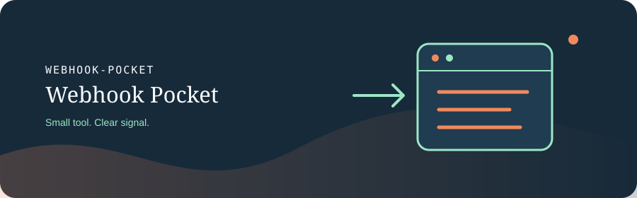

<div align="center">



# Webhook Pocket

**A localhost-first webhook catcher that records redacted request metadata as JSONL.**

[](https://www.python.org/) [](LICENSE)

</div>

## Why it exists

Give integrations a safe local endpoint while you inspect the requests they send. Binds to 127.0.0.1 by default, limits request bodies to 1 MiB and redacts authorization and cookie headers. It is a development aid, not an internet-facing production receiver.

## Features

- Localhost-only default bind
- JSONL event capture with timestamp and body preview
- Authorization and cookie header redaction
- Request-size limit and graceful Ctrl+C shutdown

## Quick start

Python 3.10+; no third-party packages.

```bash
git clone https://github.com/MofidChallenge10/webhook-pocket.git
cd webhook-pocket
python tool.py --help
```

### Example

```bash
python tool.py --port 8787 --output events.jsonl
```

## Self-test

```bash
python tool.py --self-test
```

The self-test uses the standard-library `unittest` module. Network-based tools do not contact external services during self-test.

## Scope and safety

Binds to 127.0.0.1 by default, limits request bodies to 1 MiB and redacts authorization and cookie headers. It is a development aid, not an internet-facing production receiver. Review output before using it in production workflows.

## Design notes

The illustration is an original lightweight SVG. Motion is decorative and stops when `prefers-reduced-motion` is enabled; CLI output remains plain and pipe-friendly.

## Contributing

Issues and pull requests are welcome. Keep dependencies minimal, add focused tests for behavior changes, and update examples when options change.

## License

MIT — see [LICENSE](LICENSE).
